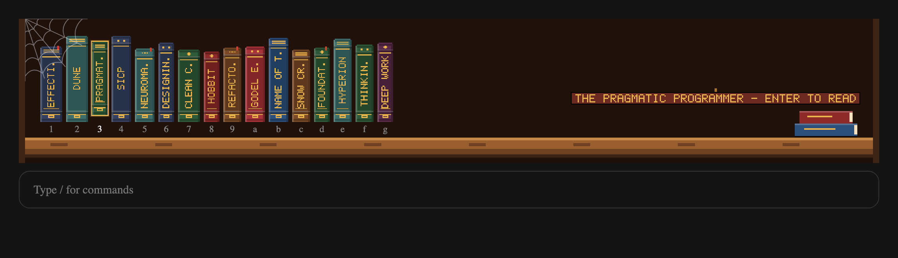
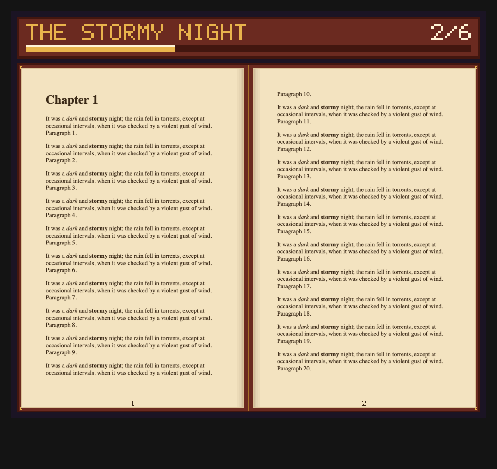
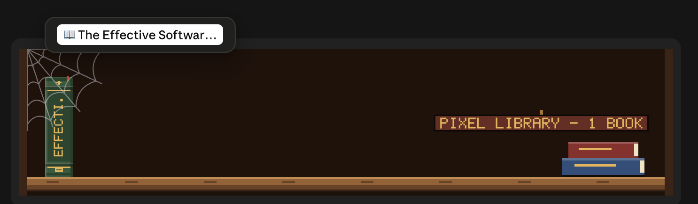
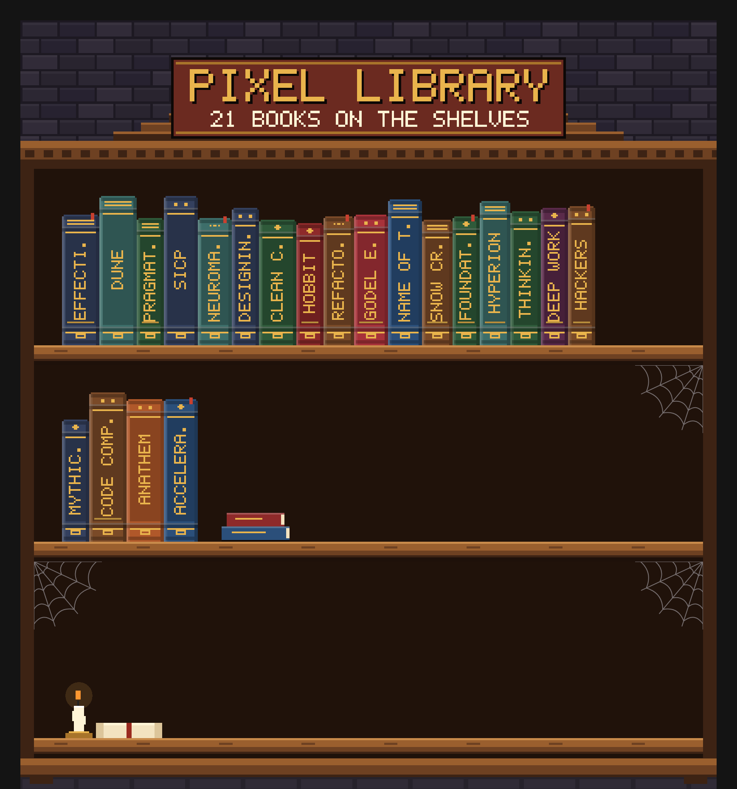

# Pixel Library

A retro pixel-art bookshelf for Claude Code. Shelve your own PDFs and EPUBs, then read them in a sepia two-page book while Claude works.



- **A shelf stuck to the prompt.** `/lib` pins one full-width shelf of book spines right above the message box. Every book gets its own colour, height and gilt ornaments, with its title stamped up the spine.
- **A real book reader.** Picking a book opens it in the side pane as two facing pages on a leather board, with page numbers, a progress ribbon and your place remembered per book.
- **PDF and EPUB.** PDFs are drawn page by page. EPUBs are typeset by macOS into proper pages, with headings, italics and their own cover.
- **Local only.** Books live in `~/.claude/library` on your machine. Nothing is uploaded anywhere.
- **Only when you call it.** Nothing appears until you type `/lib`, and `/lib` again puts it away.



## Requirements

- **macOS.** Pages are drawn with the PDFKit and AppKit frameworks that ship with macOS, run through `osascript`, `unzip` and `sips`. Nothing else to install.
- **The Claude desktop app** (the Code tab) for the pixel shelf and the reader. In a plain terminal, the pane shows a text list of your books instead.
- **A Claude Code version with function-hook mods.**

## Install

At the prompt of a Claude Code terminal session:

```
/plugin install pixel-library --marketplace Rvey/pixel-library
```

Answer `y` to add the marketplace, then pick the **user** scope so `/lib` works in every project.

Or from a shell:

```bash
claude plugin install pixel-library --marketplace Rvey/pixel-library
```

In the desktop app, where `/plugin` does not run: click **+** next to the prompt box, then **Plugins**, **Add marketplace** with `Rvey/pixel-library`, then **Add plugin**.

## Guide

### 1. Shelve a book

Any of these work:

```
/lib add ~/Downloads/some-book.pdf
/lib add ~/Downloads/another-book.epub
```

Or drop `.pdf` and `.epub` files straight into `~/.claude/library` (`/lib folder` opens it in Finder), then type `/lib` to rescan.

The first time an EPUB is shelved, it takes a few seconds to typeset. After that it opens instantly.

### 2. Open the shelf

```
/lib
```

The shelf appears above the message box. Type `/lib` again to hide it.



### 3. Pick a book

- **Mouse:** hover a spine and click the button that appears, or click the number under the spine.
- **Keyboard:** press **ctrl+x**, then **Tab**, to give the shelf the keyboard. **Tab**, **Shift+Tab** or the arrow keys move between books; the chosen book is pulled up off the plank with a gold outline, and its title shows on the plaque. **Enter** opens it. Each spine's key (**1–9**, then **a–z**) jumps straight to that book.
- **By name:** `/lib dune` opens the first book whose title contains "dune".

### 4. Read

| Key | Does |
| --- | --- |
| `n` or Enter | next pages |
| `p` | previous pages |
| `b` | back to the shelf |
| Escape | close the reader |

The buttons under the pages do the same, plus first page, last page, **Go to page**, and **Open in Preview / Books** for the original file.

### The full bookcase

`/lib <title>` and the **b** key in the reader open the side pane on the whole bookcase: a stone wall, a carved sign, shelves of spines, cobwebs, a candle and a forgotten scroll.



## Commands

| Command | What it does |
| --- | --- |
| `/lib` | show or hide the shelf above the prompt |
| `/lib add <path>` | shelve a PDF or EPUB |
| `/lib <title>` | open the first book whose title matches |
| `/lib folder` | open `~/.claude/library` in Finder |

## How it works

- `hooks/register.tsx` is the mod: the `/lib` command, the shelf band above the prompt and the reader pane.
- `hooks/pixel.ts` draws everything as SVG pixel art, including a hand-made 5×7 bitmap font, so the look doesn't depend on installed fonts.
- `hooks/helper.ts` holds a small JavaScript-for-Automation script, run with `osascript`. It reads PDF info, draws pages to images with PDFKit, and typesets EPUB chapters into a 6×9″ PDF with the macOS text system.
- Pages are cached in `~/.claude/library/.cache`, and your place in each book is remembered between sessions.

## Develop

```bash
claude plugin validate .
claude plugin test .
```

To try changes, start a session with `claude --plugin-dir /path/to/pixel-library`.

## License

MIT
